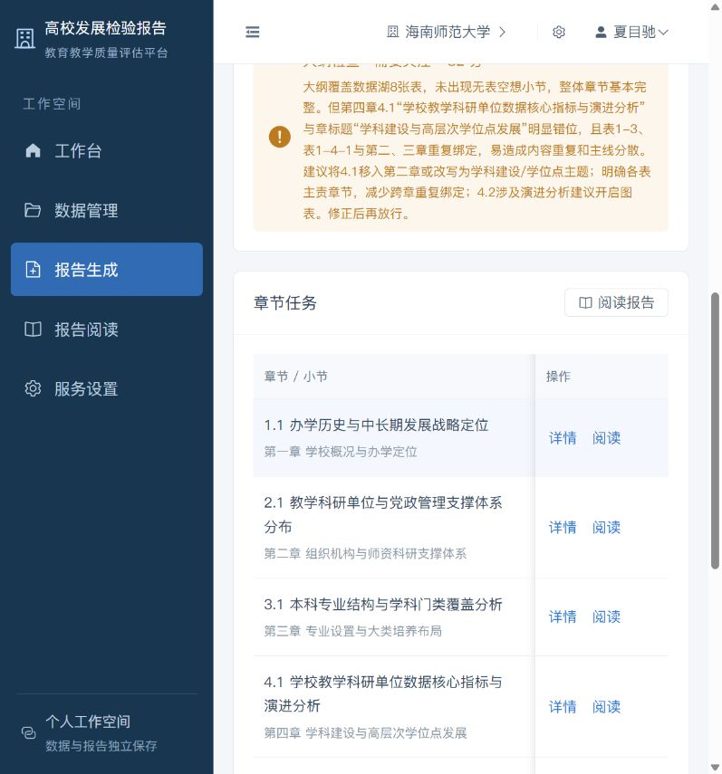
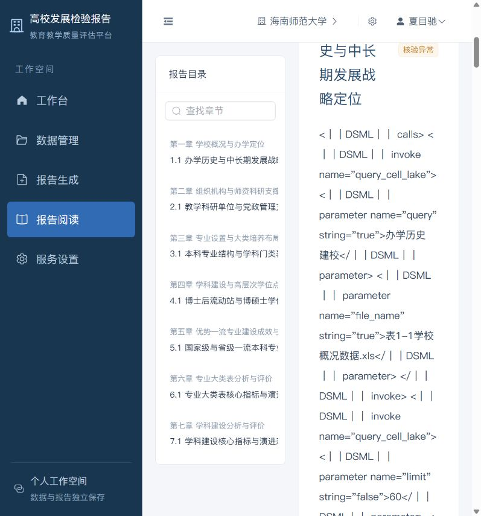
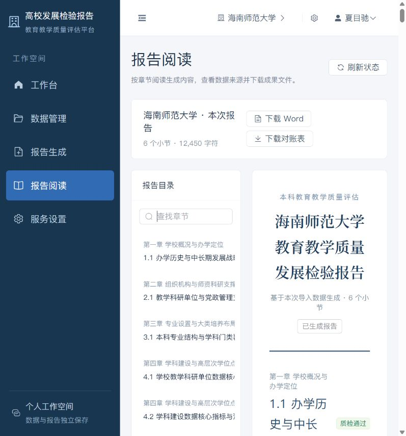
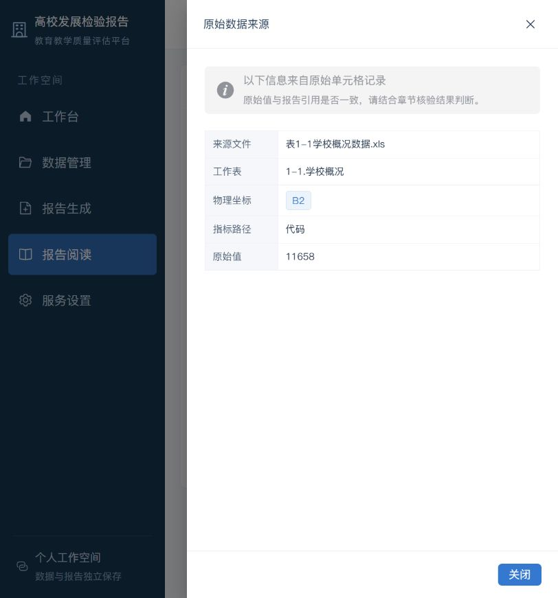
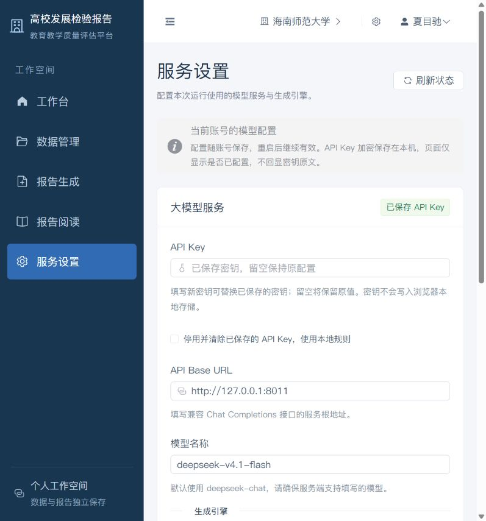
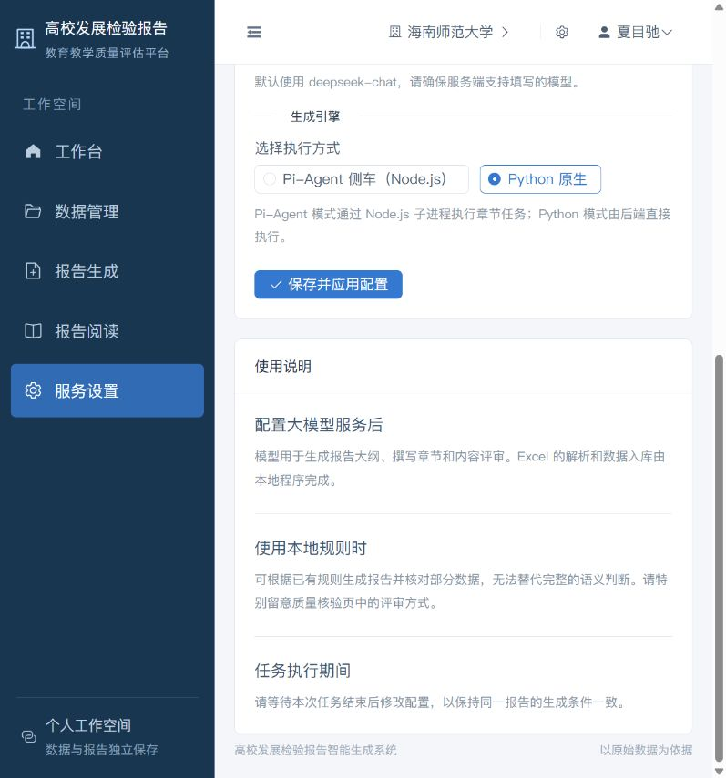

# 2026-10-18 端到端测试执行报告

> 测试人：LHRCarrier
> 测试时间：2026-10-18 20:39–21:38（Asia/Shanghai）

## 1. 执行结论

本轮针对 `feature/Frontend-makeover` 完成了工作台、数据、配置、生成、阅读、引用和导出主链路测试。

- 执行用例：20 项
- 通过：11 项
- 失败：8 项
- 未确认：1 项
- 关键结论：前端基础交互和引用穿透可用；真实模型链路与质量门禁存在 P0/P1 级问题，当前版本不建议直接用于正式报告交付。

## 2. 环境信息

| 项目 | 值 |
|---|---|
| 日期 | 2026-10-18（Asia/Shanghai） |
| 分支 | `feature/Frontend-makeover` |
| 提交 | `726f227` |
| 前端 | http://localhost:5173 |
| 后端 | http://127.0.0.1:8008 |
| Go 测试转发 | http://127.0.0.1:8011 |
| 浏览器 | Codex 内嵌浏览器 |
| Node.js | v24.11.1 |
| npm | 11.10.1 |
| Python | 3.13.9（`backend/.venv`） |
| 模型 | `deepseek-v4.1-flash`（OpenCode Go） |
| 数据 | `example/` 下 8 个 Excel，8 个工作表，2,221 个单元格 |

> 说明：OpenCode Go 接口要求 `x-opencode-session` 请求头。为验证应用的真实模型链路，本轮使用了只监听 `127.0.0.1:8011` 的临时转发器注入该头；该转发器不是产品功能。

## 3. 用例结果

| 编号 | 用例 | 结果 | 说明 |
|---|---|---|---|
| TC-01 | 前后端服务启动与健康检查 | 通过 | 5173/8008 正常，`/healthz` 返回 healthy |
| TC-02 | 服务重启后的会话持久化 | 通过 | 后端重启、页面刷新后仍为当前账号 |
| TC-03 | 示例数据载入 | 通过 | 8 个文件、8 个工作表、2,221 个单元格，识别为“海南师范大学” |
| TC-04 | 数据目录搜索 | 通过 | 搜索“专业”返回 3 个工作表 |
| TC-05 | 工作表字段详情 | 通过 | 正确显示 15 个字段、来源文件、行数 |
| TC-06 | 模型配置保存与持久化 | 通过 | Base URL、模型、引擎模式保存成功；API Key 不回显 |
| TC-07 | 配置表单校验 | 通过 | 非法 URL、空模型均被拦截并提示 |
| TC-08 | 未登录接口鉴权 | 通过 | 业务接口 401，`healthz` 200 |
| TC-09 | 报告阅读与目录搜索 | 通过 | 正文渲染正常；目录搜索“学科”可过滤 |
| TC-10 | 引用来源穿透 | 通过 | B2：表1-1学校概况数据.xls / 1-1.学校概况 / 代码 / 11658 |
| TC-11 | Word / Excel 导出接口 | 通过 | 两个下载请求均 200；DOCX 可打开，XLSX 可打开 |
| TC-12 | OpenCode Go 套餐接入 | 失败 | 缺少 `x-opencode-session` 时 400；应用未内置该头 |
| TC-13 | Pi-Agent 侧车真实模型生成 | 失败 | 正文出现 97 段 DSML 工具调用标记，0 引用 |
| TC-14 | 模型 402 失败降级 | 失败 | 静默转本地合成，页面仍显示生成成功 |
| TC-15 | 质量门禁与导出条件 | 失败 | 有核验异常仍 100% 完成并导出，封面宣称 100% 通过 |
| TC-16 | 降级内容事实准确性 | 失败 | 30/29/25 等数量与真实工作表行数不符 |
| TC-17 | 导出文档封面日期 | 失败 | 2026-10-18 生成，封面固定为“2026 年 9 月” |
| TC-18 | 页面切换后的抽屉状态 | 失败 | 来源抽屉跨越路由保持打开 |
| TC-19 | 遥测 Token/费用记录 | 失败 | 402 降级仍记录 Token、费用和 95 分质检 |
| TC-20 | 内嵌浏览器下载落盘 | 未确认 | 服务端 200，但 Downloads 未发现文件 |

## 4. 关键运行记录

### 4.1 示例数据与配置

- 内置示例数据载入成功：`8 个文件 · 8 个工作表 · 2,221 个数据单元格`
- 模型服务：`deepseek-v4.1-flash`
- 当前引擎：Python 原生
- 当前 Base URL：本机 Go 测试转发 `http://127.0.0.1:8011`

### 4.2 Python 原生真实模型结果

- 生成小节：6
- 质检通过：5
- 核验异常：1（2.1）
- 引用核验：小节 2.1 为 24/24 单元格值匹配，但 Jev 仍拒绝，原因是引用了未提供的事实数据 `B12-B16`、`9900` 等
- DOCX：94 个非空段落，2 张内嵌图片，无 DSML 标记
- XLSX：
  - `指标覆盖率矩阵`：19 行 × 6 列
  - `全文数字对账总表`：150 行 × 9 列

### 4.3 Pi-Agent 真实模型结果

- 生成小节：8
- 有效引用：0
- 质检通过：0
- 正文出现原始 `<｜｜DSML｜｜ ...>` 工具调用标记
- 导出 DOCX：段落 125 个，其中 97 个含 `DSML`

### 4.4 402 降级结果

- 上游实际返回：`402 Insufficient account funds`
- 页面仍显示：`生成完成`、`100%`、`8/8 质检通过`
- 降级内容错误示例：第二章“30 个”、第五章“29 项”、第六章“25 项”，与真实行数 36+29、39、129 不一致

### 4.5 报告生成耗时汇总

| 批次 | 开始时间 | 完成时间 | 墙钟耗时 | 小节数 | 结论 |
|---|---|---|---|---|---|
| 402 降级 / 本地规则 | 20:47:26 | 20:47:46 | 20 秒 | 8 | 仅作速度对照，未发生真实模型调用 |
| Pi-Agent / Go 真实模型 | 20:53:38 | 20:58:12 | 4 分 34 秒 | 8 | 0/8 通过，DSML 污染，报告不可用 |
| Python 原生 / Go 真实模型 | 20:59:00 | 21:04:32 | 5 分 32 秒 | 6 | 5/6 通过，1 个小节核验异常 |

详细阶段拆分见：`2026-10-18_报告生成耗时记录.md`。
### 4.6 关键页面截图

#### 数据载入与统计

#### 生成完成与质量门禁

#### 核验异常详情

#### Pi-Agent DSML 标记泄露

#### 报告阅读与引用穿透

#### 模型服务配置

### 4.7 通用模型输出守卫修复验证

- 新增厂商无关中间件：`backend/app/pipeline/output_guard.py`
- 新增厂商规则注册表：`backend/app/pipeline/provider_guards.py`
- DSML 仅为 DeepSeek 规则：`backend/app/pipeline/dsml_guard.py`
- 主流程只消费通用的 `guard_content_stream` / `sanitize_model_output`
- 检测到任意注册规则命中时：前端清空本轮内容、后端丢弃本轮输出并回落
- 单元测试：`backend/test_output_guard.py`，16/16 通过
- 实际泄漏快照：8 个小节按 7 字符分片过闸，安全输出中 DSML 数量为 0
- 前端生产构建：`npm run build` 通过
## 5. 证据与产物

- 测试计划：`local/tests/2026-10-18_测试计划.md`
- 缺陷记录：`local/tests/2026-10-18_缺陷记录.md`
- 402 降级样例：`local/tests/artifacts/fallback_402/`
- Pi-Agent DSML 样例：`local/tests/artifacts/live_go_dsml/`
- Python 原生样例：`local/tests/artifacts/live_go_python_native/`
- 后端日志：`local/process/logs/backend.out.log`、`backend.err.log`
- 前端日志：`local/process/logs/frontend.out.log`、`frontend.err.log`
- Go 转发日志：`local/process/logs/opencode_proxy.out.log`、`opencode_proxy.err.log`

## 6. 建议修复顺序

1. BUG-01：补齐 OpenCode Go 会话头支持。
2. BUG-02：解析或拦截 DeepSeek DSML/工具调用标记，禁止写入正文。
3. BUG-03/04：模型失败与质检失败必须显式阻断或显著降级提示。
4. BUG-05/08：修正降级统计与遥测数据，禁止伪造成本与通过率。
5. BUG-06/07：修正导出日期和路由抽屉状态。

## 7. 当前运行状态

- 前端、后端、Go 测试转发均已重启并可用。
- 当前页面停留在报告阅读页。
- 当前配置指向本机 Go 测试转发；若重启电脑，需要重新启动 `local/scratch/opencode_go_proxy.py`。
