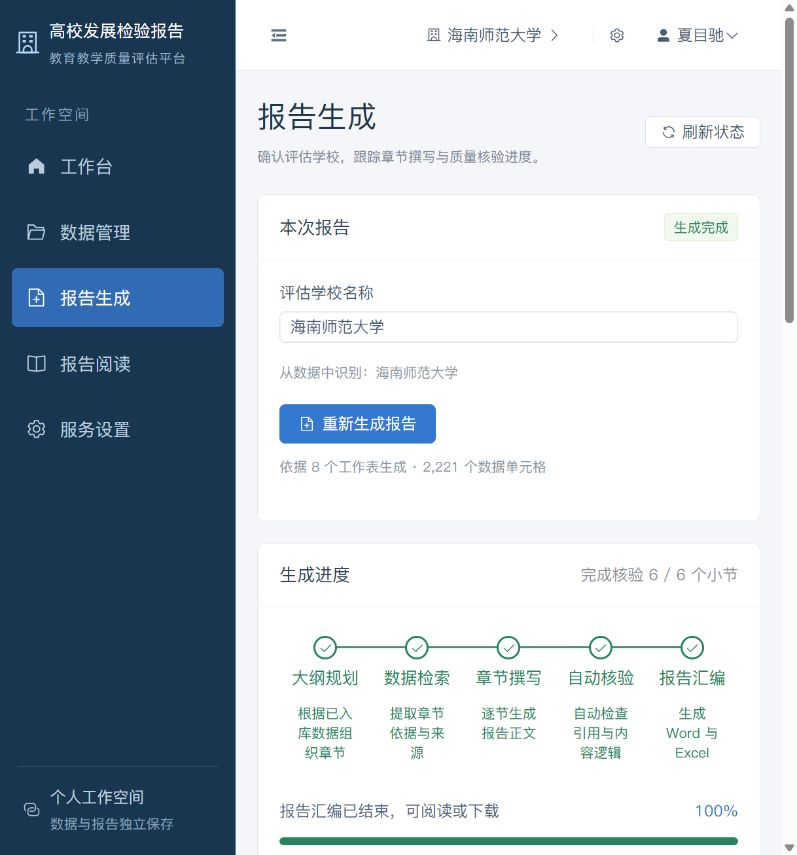
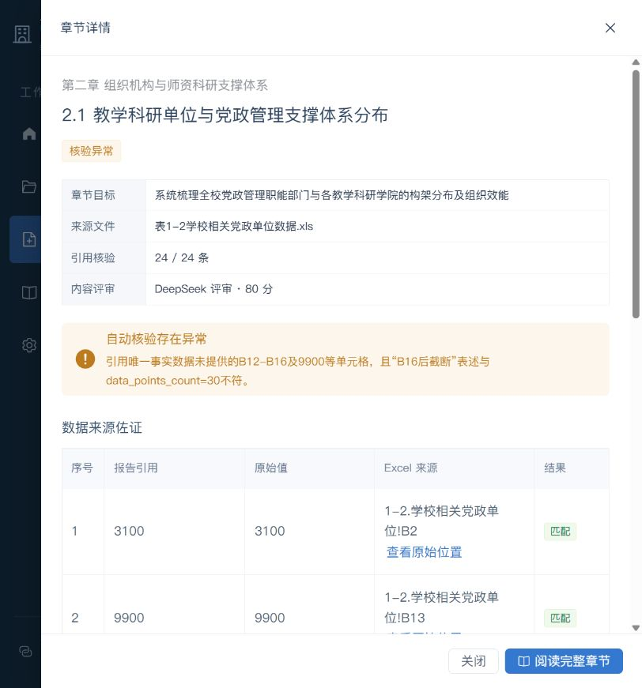
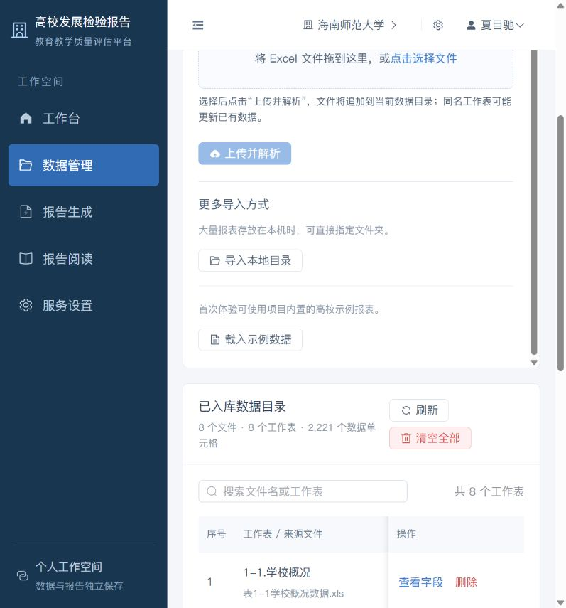

# 2026-10-18 缺陷记录

> 测试人：LHRCarrier
> 测试时间：2026-10-18 20:39–21:38（Asia/Shanghai）

## 严重级别定义

- P0：阻断核心业务、导致数据/报告不可信，或造成明显安全/合规风险。
- P1：主流程可继续，但会产出错误结果、误导用户或绕过质量门禁。
- P2：局部功能异常、状态不一致、体验或可维护性问题。

---

## BUG-20261018-01：OpenCode Go 套餐无法直接被应用接入

- **级别**：P0
- **测试人**：LHRCarrier
- **发现日期**：2026-10-18
- **测试时间**：2026-10-18 20:39–21:38（Asia/Shanghai）
- **环境**：`feature/Frontend-makeover` / `726f227` / 前端 5173 / 后端 8008
- **前置条件**：使用 OpenCode Go 套餐密钥；模型 `deepseek-v4.1-flash`。
- **复现步骤**：
  1. 向 `https://opencode.ai/zen/go/v1/chat/completions` 发送 Chat Completions 请求，仅携带 `Authorization: Bearer <key>`。
  2. 保持请求体中的模型为 `deepseek-v4.1-flash`。
  3. 观察上游返回。
  4. 在同一请求中追加 `x-opencode-session: <uuid>` 后重试。
- **预期结果**：应用应支持 Go 套餐所需的会话头；配置 Go Base URL 后可直接生成。
- **实际结果**：不带会话头返回 `400 MissingSessionID`；带会话头返回 `200`。应用当前请求构造器只发送 `Authorization` 和 `Content-Type`，没有发送 `x-opencode-session`。
- **证据**：
  - 直接请求无会话头：`STATUS=400`，错误 `Request is missing x-opencode-session`。
  - 带会话头：`STATUS=200`，返回正常 completion。
  - 代码位置：`backend/app/pipeline/agent_runner.py` 的请求头构造。
- **影响**：用户按常规方式填写 OpenCode Go 地址后，真实模型链路不可用；错误还可能被降级逻辑吞掉。
- **状态**：待修复。当前测试通过本机转发器注入会话头绕过。

---

## BUG-20261018-02：Pi-Agent 侧车把 DeepSeek 工具调用标记当正文写入报告

- **级别**：P0
- **测试人**：LHRCarrier
- **发现日期**：2026-10-18
- **测试时间**：2026-10-18 20:39–21:38（Asia/Shanghai）
- **环境**：Pi-Agent 侧车模式；OpenCode Go；模型 `deepseek-v4.1-flash`；示例数据 2,221 个单元格。
- **前置条件**：模型服务可正常返回；Base URL 指向本机 Go 转发通道。
- **复现步骤**：
  1. 服务设置中保存 `http://127.0.0.1:8011`、模型 `deepseek-v4.1-flash`。
  2. 生成引擎选择“Pi-Agent 侧车（Node.js）”。
  3. 进入“报告生成”，点击“开始生成报告/重新生成报告”并确认。
  4. 等待流水线达到 100%。
  5. 打开“报告阅读”，查看第一章正文。
  6. 下载 Word，检查文档段落。
- **预期结果**：工具调用应由侧车解析并执行，最终正文只包含自然语言和有效引用。
- **实际结果**：8/8 小节均显示 `未提取引用 / 核验异常`；正文出现 `<｜｜DSML｜｜ calls>`、`<｜｜DSML｜｜ invoke ...>`、`<｜｜DSML｜｜ parameter ...>` 等原始工具调用标记。导出的 Word 中检出 97 个含 `DSML` 的段落。
- **证据**：
  - `local/tests/artifacts/live_go_dsml/pipeline_checkpoint.json`
  - `local/tests/artifacts/live_go_dsml/高校发展检验与质量评估报告_海南师范大学.docx`
  - 该 Word 文件：段落 125 个，其中 97 个含 `DSML`。
  - 所有小节 `citations=0`、`passed=False`。
- **影响**：报告正文和正式 Word 交付物不可用；用户可能误把内部协议文本当成报告内容。
- **状态**：待修复。

---

## BUG-20261018-03：模型接口 402 失败后静默降级，并显示为生成成功

- **级别**：P1
- **测试人**：LHRCarrier
- **发现日期**：2026-10-18
- **测试时间**：2026-10-18 20:39–21:38（Asia/Shanghai）
- **环境**：OpenCode Zen 按量接口；模型 `deepseek-v4.1-flash`；账户余额不足。
- **前置条件**：保存 `https://opencode.ai/zen/v1` 与有效格式的 API Key，但账户无可用余额。
- **复现步骤**：
  1. 在服务设置中保存上述 Base URL 与模型。
  2. 载入示例数据，启动完整生成。
  3. 观察页面进度、执行记录与后端日志。
  4. 打开报告阅读并下载 Word。
- **预期结果**：接口返回 `402 Insufficient account funds` 时，应明确提示模型调用失败，停止或征得用户确认后再降级；报告应标注“本地规则生成”。
- **实际结果**：后端日志连续出现 `API HTTP 402`；页面仍显示“生成完成”“100%”“8/8 质检通过”；报告内容来自确定性降级合成，页面和报告均未提示真实模型调用失败。
- **证据**：
  - 后端日志：`Pi-Agent Core API ... API HTTP 402`（8 次）。
  - 上游响应：`{"error":{"type":"server_error","message":"Upstream request failed: Insufficient account funds"}}`
  - 降级产物：`local/tests/artifacts/fallback_402/`
- **影响**：用户无法判断报告是真实模型生成还是本地规则合成，可能把降级内容当成模型结论。
- **状态**：待修复。

---

## BUG-20261018-04：存在核验失败的小节时，仍显示 100% 完成并导出，封面宣称 100% 通过

- **级别**：P1
- **测试人**：LHRCarrier
- **发现日期**：2026-10-18
- **测试时间**：2026-10-18 20:39–21:38（Asia/Shanghai）
- **环境**：Python 原生引擎；OpenCode Go；`deepseek-v4.1-flash`。
- **前置条件**：已载入示例数据，完成一次真实模型生成。
- **复现步骤**：
  1. 使用 Python 原生引擎生成报告。
  2. 等待任务结束。
  3. 查看“章节任务”列表和“生成进度”。
  4. 下载 Word，检查封面“质检裁定”字段。
- **预期结果**：任一必需小节核验失败时，应阻止“100% 成功”的最终状态或明确标记交付为不通过；封面不得宣称全部通过。
- **实际结果**：6/6 小节“完成核验”，其中 `2.1` 为“核验异常”（Jev 评分 0.8，拒绝原因明确为引用了未提供的事实数据）；整体仍显示“生成完成 100%”，Word 封面固定显示“Jev 极速质量决策与 100% 物理对账通过”。
- **证据**：
  - `local/tests/artifacts/live_go_python_native/pipeline_checkpoint.json`
  - `local/tests/artifacts/live_go_python_native/高校发展检验与质量评估报告_海南师范大学.docx`
  - 小节 2.1：`audit_pass=True`、`pass_rate=100`，但 `jev_approved=False`、`passed=False`，拒绝原因包含“引用唯一事实数据未提供的 B12-B16 及 9900 等单元格”。

- **影响**：正式交付物包含与质量结论相矛盾的声明，属于报告可信度问题。
- **状态**：待修复。

---

## BUG-20261018-05：确定性降级内容把“抓取样本数”误写为业务总量，产生事实错误

- **级别**：P1
- **测试人**：LHRCarrier
- **发现日期**：2026-10-18
- **测试时间**：2026-10-18 20:39–21:38（Asia/Shanghai）
- **环境**：402 降级路径；示例数据。
- **前置条件**：使真实模型调用失败，触发本地确定性合成。
- **复现步骤**：
  1. 使用余额不足的模型配置生成报告。
  2. 打开报告阅读，查看第二章、第五章、第六章正文。
  3. 对照“数据管理”中的工作表行数。
- **预期结果**：数量结论应来自真实工作表或明确标注样本范围；无法统计时不得给出总数。
- **实际结果**：
  - 第二章写“党政管理支撑与教学科研单位累计达 30 个”；数据目录显示相关工作表分别为 36 行和 29 行。
  - 第五章写“本科专业及大类培养项目累计达 29 项”；来源表实际为 39 行。
  - 第六章写“累计达 25 项”；来源表实际为 129 行。
- **证据**：`local/tests/artifacts/fallback_402/pipeline_checkpoint.json`；数据管理页显示 `36 / 29 / 39 / 129` 行。

- **初步定位**：`pi-main/pi_agent_sidecar.mjs` / `backend/sidecar/pi_agent_core_bundle.mjs` 的确定性合成逻辑使用 `cellMappings.length` 作为总数。
- **影响**：降级报告的数字结论不可信，且会被标记为“质检通过”。
- **状态**：待修复。

---

## BUG-20261018-06：Word 封面编制日期被硬编码为“2026 年 9 月”

- **级别**：P2
- **测试人**：LHRCarrier
- **发现日期**：2026-10-18
- **测试时间**：2026-10-18 20:39–21:38（Asia/Shanghai）
- **环境**：所有导出路径。
- **前置条件**：在 2026-10-18 生成并下载 Word。
- **复现步骤**：
  1. 生成任一报告。
  2. 下载 Word 并用 Word 或 `python-docx` 打开。
  3. 查看封面的“编 制 日 期”字段。
- **预期结果**：显示生成时的实际年月，例如“2026 年 10 月”。
- **实际结果**：固定显示“2026 年 9 月”，与实际生成日期不一致。
- **证据**：`backend/app/core/docx_exporter.py:94` 存在硬编码字符串；本次 DOCX 首段内容即为“编 制 日 期：2026 年 9 月”。
- **影响**：正式交付物日期错误。
- **状态**：待修复。

---

## BUG-20261018-07：引用来源抽屉在页面切换后仍保持打开

- **级别**：P2
- **测试人**：LHRCarrier
- **发现日期**：2026-10-18
- **测试时间**：2026-10-18 20:39–21:38（Asia/Shanghai）
- **环境**：报告阅读页。
- **前置条件**：报告中存在可点击的“查看数据来源”。
- **复现步骤**：
  1. 打开报告阅读。
  2. 点击任意“查看数据来源”，确认右侧抽屉打开。
  3. 不关闭抽屉，直接切换到“数据管理”或修改 URL 到 `#/data`。
  4. 观察新页面。
- **预期结果**：路由切换时自动关闭引用抽屉，避免遮挡新页面。
- **实际结果**：抽屉保持打开并覆盖“数据管理”页面，直到手动点击“关闭”。
- **证据**：本次在阅读页打开 B2 单元格来源后切换 `#/data`，抽屉仍显示“原始数据来源”。
- **影响**：页面状态残留，可能阻塞用户操作，属于明显的状态管理缺陷。
- **状态**：待修复。

---

## BUG-20261018-08：降级路径仍写入估算 Token 和费用，造成遥测数据失真

- **级别**：P2
- **测试人**：LHRCarrier
- **发现日期**：2026-10-18
- **测试时间**：2026-10-18 20:39–21:38（Asia/Shanghai）
- **环境**：402 降级路径。
- **前置条件**：真实模型调用失败，流水线转入确定性合成。
- **复现步骤**：
  1. 使用无余额模型配置完成一次生成。
  2. 查看 `backend/data/users/1/telemetry_traces.jsonl`。
  3. 对比后端日志中的 402 错误与遥测记录。
- **预期结果**：降级记录应标记 `provider=local_fallback`，真实 Token/费用应为 0，或明确标注为估算值。
- **实际结果**：模型调用未成功，但遥测仍记录 `prompt_tokens`、`completion_tokens`、`est_cost_cny`，且 `jev_score=0.95`、`audit_passed=true`。
- **证据**：`local/tests/artifacts/fallback_402/telemetry_traces.jsonl`；后端日志存在 8 次 402。
- **初步定位**：`backend/app/pipeline/stages.py` 使用字符长度估算 Token，`backend/app/core/telemetry_service.py` 按固定价格估算费用。
- **影响**：监控和成本统计不可作为真实模型调用依据。
- **状态**：待修复。

---

## 观察项（非已确认缺陷）

- **OBS-01 内嵌浏览器下载未落盘**：点击“下载 Word/下载对账表”后，后端日志确认两个导出接口均返回 200，但 `Downloads` 目录未出现文件。需要在内置浏览器之外的 Chrome/Edge 复测，暂不判定为产品缺陷。
- **OBS-02 大纲检查为“需要关注”时仍允许生成**：Python 原生模式本次大纲评分 82 分并明确提示 4.1 与章标题错位，但生成仍继续。是否应强制确认，需产品策略确认。

